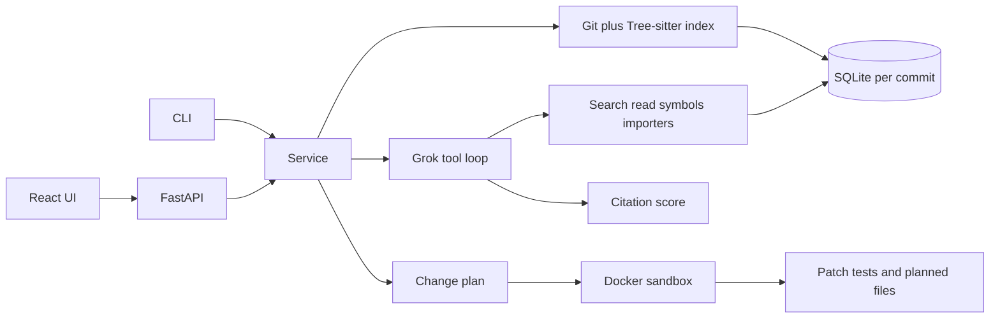

# RepoDoctor

RepoDoctor answers questions about a git repository only when it can point at real files and lines. A proposed change counts as successful only when a Docker sandbox applies the diff and the tests pass.

## What it measures

- **Citation support.** A citation counts when the file exists, the line range is inside that file, the range is no wider than the snippet, the snippet matches those lines, and the same text was returned by a tool in that run.
- **Sandbox pass.** The diff applies, the plan's test command exits 0, and every changed file was listed in the plan. The host working tree is not modified.

`repodoctor eval` prints both rates for two small fixtures.

## Requirements

- Python 3.10+
- Git
- An xAI API key in `.env` as `XAI_API_KEY`
- Docker Desktop for `verify` and `eval`

```bash
python -m pip install -e ".[dev]"
```

Optional environment variables:

- `XAI_API_KEY`
- `REPODOCTOR_CHAT_MODEL` (default `grok-4`)
- `REPODOCTOR_DATA` (default `~/.repodoctor`)
- `REPODOCTOR_SANDBOX_IMAGE` (default `repodoctor-sandbox`)
- `REPODOCTOR_API_TOKEN` (required when `repodoctor serve` binds a host other than localhost)

Values in `.env` replace variables already set in the process. A request to a non-local API must send `X-RepoDoctor-Token` or `Authorization: Bearer`. The web UI sends `VITE_API_TOKEN` when that variable is set.

## Commands

```bash
repodoctor index PATH
repodoctor ask PATH "Where is the server started?"
repodoctor plan PATH "Add a timeout to the client call"
repodoctor verify PATH
repodoctor eval
repodoctor serve
```

The first `verify` builds the sandbox image. Answers and plans call Grok with RepoDoctor's tools. Search mixes FTS5 with local token vectors. The API key stays in `.env` and is not committed.

## API and UI

```bash
repodoctor serve
cd web
npm install
npm run dev
```

Open `http://127.0.0.1:5173`. The page sends a server-side repository path, then shows the answer, citation checks, the change plan, and the sandbox result.

## Architecture

The CLI and the web UI are two doors into the same Python service. The browser never reads the disk. It sends a repository path to FastAPI, and FastAPI calls the same functions as the CLI.



1. **Index.** `git ls-files --cached --others --exclude-standard` selects tracked files and untracked files that are not ignored. The indexer reads the working tree, so uncommitted edits are included. Tree-sitter extracts symbols and imports for Python, JavaScript, and TypeScript. Other text files are stored as line chunks only. Chunks overlap by about 15 lines. Entry points come from `__main__`, `pyproject.toml` scripts, and `package.json`. The database lives under `~/.repodoctor` and is keyed by the absolute path plus `HEAD`. Reindexing the same commit replaces the file rows and keeps earlier ask and plan runs. One lock per database serializes overlapping requests.

2. **Search.** Each question can call `search`, `read_file`, `symbols`, `importers`, `entry_points`, and `repo_map`. `search` mixes SQLite FTS5 with hashed token vectors. Those vectors are not neural embeddings. Symbol and importer lookups escape `%` and `_`. Every tool result keeps a path and a line range. That span is the only text a later citation is allowed to use.

3. **Answer.** Grok (`grok-4` by default) runs a tool loop with a step cap. It must finish by calling `submit_answer`. RepoDoctor then scores each citation. A citation is supported only when the file exists, the line range is inside the file, the range is no wider than the snippet, the snippet matches those lines, and that text came back from a tool in this run. The host repository is not modified.

4. **Plan and verify.** A change request returns a plan before any write: goal, steps, allowed files, risks from importers, a test command, and a unified diff. `verify` accepts `pytest`, `python -m pytest`, `npm test`, and `node --test`. Shell syntax is rejected before Docker starts. The run clones `HEAD` into a temp directory, builds `repodoctor-sandbox` if needed, and runs `docker run --network none`. The container applies the diff and runs the allowed command. The run passes only when the patch applies, the command exits 0, and every changed file was listed in the plan.

5. **Eval.** `repodoctor eval` copies `tests/fixtures/py_calc` and `tests/fixtures/ts_greet` into a temp git repo, then prints the citation support rate and the sandbox pass rate.

| Path | Role |
| --- | --- |
| `src/repodoctor/indexer.py`, `parse.py` | Tree-sitter index |
| `src/repodoctor/search.py`, `tools.py` | Hybrid search and tool results |
| `src/repodoctor/grok_model.py`, `agent.py` | Grok tool loop and cited answers |
| `src/repodoctor/grounding.py` | Citation checks |
| `src/repodoctor/planner.py`, `sandbox.py` | Change plan and Docker verification |
| `src/repodoctor/api.py`, `cli.py` | HTTP and terminal entry points |
| `web/` | React viewer |
| `docker/sandbox.Dockerfile` | Offline Python and Node image |
